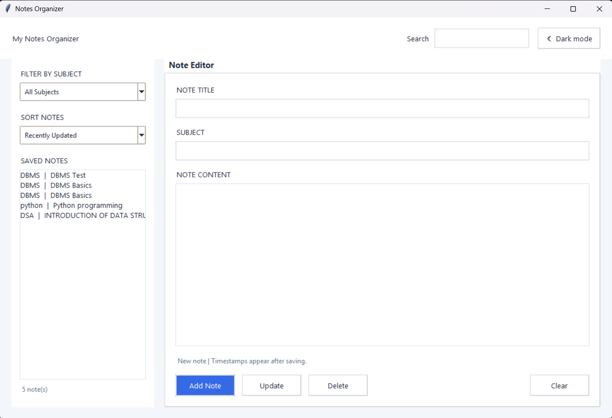

# Notes Organizer

## About the Project
Notes Organizer is a simple Python desktop application that helps students create, organize, search, edit, and delete their study notes.

## Features
- Add new study notes
- View saved notes
- Edit existing notes
- Delete unwanted notes
- Organize notes by subject
- Search notes by title, subject, or content
- Save notes locally in a JSON file
- User-friendly graphical interface
- Dark and light mode (if enabled in the application)

## Technologies Used
- Python 3
- Tkinter
- JSON
- Git
- GitHub

## How to Run
1. Install Python 3.
2. Clone or download this repository.
3. Open the project folder in VS Code.
4. Open the terminal in the project folder.
5. Run the following command:

   ```bash
   python gui.py
   ```

## Project Files
- `gui.py` — graphical user interface
- `main.py` — command-line version of the application
- `notes.json` — locally stored notes
- `.gitignore` — files and folders Git should ignore
- `screenshot.png` — application screenshot

## Application Screenshot



## Data Storage
The application stores notes locally in `notes.json`. This allows saved notes to remain available when the application is reopened.

## Author
Student Project — Notes Organizer
